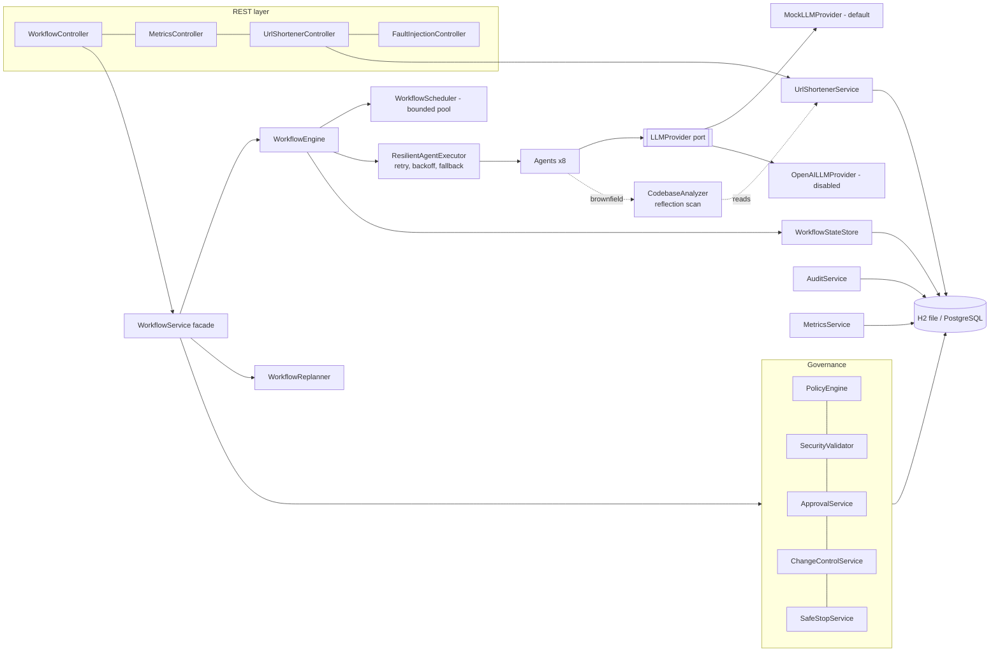

# Architecture

## Modules

Two modules in one Spring Boot application (`com.example.agentic`):

* **Module A - Agentic Engineering Platform**: `agent`, `orchestration`, `llm`, `governance`, `audit`, `metrics`, `service`, `controller`, `dto`, `domain`, `repository`, `codebase`.
* **Module B - URL Shortener** (`urlshortener.*`): the engineered application and the brownfield baseline.

Dependencies point inwards: controllers -> services -> engine/governance -> repositories. The orchestration engine
has no dependency on REST types; agents depend only on the `LLMProvider` port.



## Request flow for `POST /workflows/{id}/execute`

```mermaid
sequenceDiagram
  participant C as Client
  participant S as WorkflowService
  participant E as WorkflowEngine (coordinator thread)
  participant W as Worker threads
  participant D as Database
  C->>S: execute(id)
  S->>E: run(id)
  E->>D: snapshot (tasks, edges, outputs)
  loop until nothing runnable and nothing in flight
    E->>E: ready tasks = deps satisfied; evaluate conditions
    E->>D: approval gate? open ApprovalRequest, task WAITING_APPROVAL
    E->>W: submit agent tasks (parallel)
    W->>W: agent + LLM, retry/backoff/fallback
    W->>D: AgentExecution row per attempt
    W-->>E: outcome
    E->>D: stage artifacts, decisions, task COMPLETED (or fail -> safe-stop / failed)
  end
  E->>D: terminal decision: COMPLETED or WAITING_FOR_APPROVAL
  E-->>C: status
```

**Single-writer rule:** only the coordinator thread changes workflow/task state; worker threads run agents and write
append-only `AgentExecution` rows. This removes lost-update races on the workflow aggregate without distributed locks.

## Persistence model

| Entity | Purpose | Notable constraints / indexes |
|---|---|---|
| `ShortUrl` | URL aggregate | unique `shortCode`; index `(active, expirationDate)`; atomic counter update |
| `UrlClick` | append-only access log | index `(short_url_id, accessedAt)` and `(short_url_id, referrer)`; FK to `ShortUrl` |
| `WorkflowExecution` | workflow state, safe-stop reason, requirement version | index `status`; CAS status updates |
| `WorkflowTask` | one DAG node: status, revision, attempts, output JSON | unique `(workflow_id, nodeKey)` |
| `WorkflowDependency` | edges, with the graph revision that introduced them | unique `(workflow_id, taskKey, dependsOnKey)` |
| `AgentExecution` | one row per attempt: provider, degraded flag, duration, failure kind | index `workflow_id` |
| `ApprovalRequest` | gate decisions, who/when, replan proposal payload | index `status` |
| `AuditLog` | append-only trail (secrets redacted) | index `(workflow_id, occurredAt)` |
| `WorkflowDecision` | decision lineage (`parentDecisionIds`), superseded flag | |
| `GeneratedArtifact` | versioned artifacts: STAGED / ACCEPTED / REVERTED / SUPERSEDED | unique `(workflow_id, name, version)` |
| `WorkflowMetric` | point measurements (end-to-end latency) | index `name` |

Schema comes from Hibernate `ddl-auto=update` (documented limitation; use Flyway in production).

## URL shortener design

* Codes: 7 chars base62 from `SecureRandom` (62^7 ~ 3.5e12) or a validated custom alias (3-32 `[A-Za-z0-9_-]`, reserved words blocked).
  The database unique constraint is the source of truth; collisions retry in a fresh transaction (`ShortUrlWriter`).
* Redirect = 1 SELECT + 1 atomic `UPDATE click_count = click_count + 1` + 1 INSERT of an append-only click row, in one transaction. Status 302 (not 301) so every click is counted and caching never hides deactivation.
* Open-redirect defence: only `http`/`https`, host required, no embedded credentials, no whitespace/control chars, loopback/private literal hosts blocked.
* Expired or deactivated links answer **410 Gone**; unknown codes 404. DELETE is a soft, idempotent deactivation; history stays.
* Analytics scale path: clicks are append-only and indexed; daily and referrer stats are `GROUP BY` queries today and can move to rollup tables or a stream without changing the API.