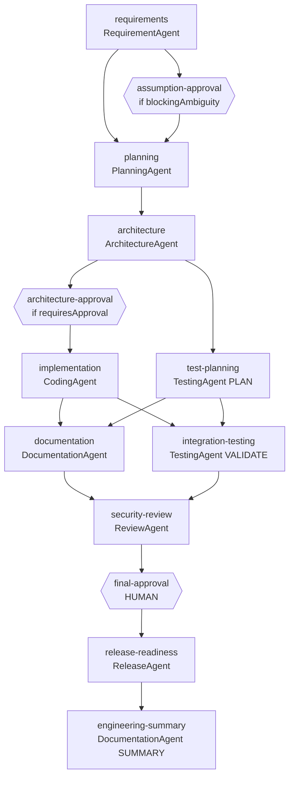
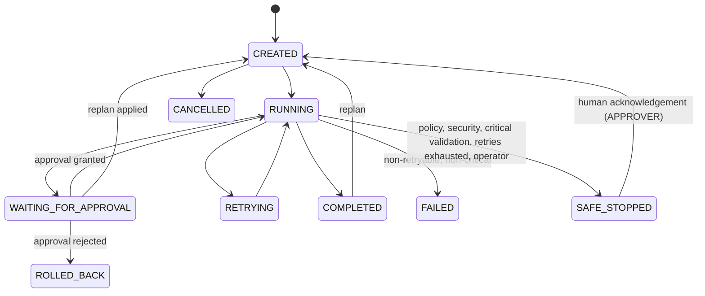

# Workflow Design

## Why a DAG and not a chain

A linear chain forces test planning to wait for implementation although both only need the architecture. A DAG
expresses *what actually depends on what*, so independent branches run in parallel, joins wait for all inputs,
conditional nodes can be skipped, and a change can be traced to exactly the downstream tasks it invalidates.

## The standard graph

Hexagons are human approval gates. `assumption-approval` and `architecture-approval` are **conditional**: they are
`SKIPPED` unless the condition (evaluated against upstream outputs) holds. A skipped node counts as satisfied.

* **Sequential:** requirements -> planning -> architecture.
* **Parallel:** `implementation` and `test-planning`; then `documentation` and `integration-testing`.
* **Join / synchronisation:** `documentation` + `integration-testing` -> `security-review`.
* **Order note:** the brief lists *Release Readiness* before *Human Final Approval* in the stage list but draws approval before release in the example diagram; this system follows the diagram (approval gates the release-readiness stage).

## Nine stages -> nodes

Requirement Understanding (`requirements`, `assumption-approval`), Task Decomposition (`planning`), Architecture and Design
(`architecture`, `architecture-approval`), Implementation (`implementation`), Testing and Validation (`test-planning`,
`integration-testing`), Documentation (`documentation`), Security and Risk Review (`security-review`), Human Final Approval
(`final-approval`), Release Readiness (`release-readiness`, `engineering-summary`).

## Execution algorithm (`WorkflowEngine`)

1. Load an immutable `WorkflowSnapshot` (tasks, edges, outputs of COMPLETED tasks = the shared `WorkflowContext`).
2. `DependencyResolver.readyTasks`: status PENDING/STALE with every dependency COMPLETED or SKIPPED.
3. For each ready task: condition false -> `SKIPPED`; approval node -> open `ApprovalRequest`, `WAITING_APPROVAL`;
   agent node -> mark `RUNNING` and submit to the bounded pool.
4. If anything changed, re-snapshot immediately (newly unlocked tasks start without waiting).
5. Otherwise block on the next completion; the coordinator persists artifacts, decisions and output, then loops.
6. Nothing runnable and nothing in flight: all satisfied -> `COMPLETED`; some task waiting -> `WAITING_FOR_APPROVAL`; else `FAILED` (deadlock guard).

Every state change is its own small transaction, so the persisted state is always resumable.

## Workflow states and legal transitions

`WorkflowStatus.allowedTargets()` encodes the table; `WorkflowStateStore.transition` validates it and applies it with a
compare-and-set `UPDATE ... WHERE status = :observed`, so two actors can never both win a conflicting transition.
`ROLLED_BACK` and `CANCELLED` are terminal; `COMPLETED` and `FAILED` can only be reopened through a replan.

## Failure handling matrix

| Failure | Classified as | Retried? | Result |
|---|---|---|---|
| LLM timeout / 503, transient DB error | TRANSIENT | yes, exponential backoff (`200ms x 2^n`, capped), up to `max-retries` | after exhaustion: degraded **fallback provider** once; if that fails -> **SAFE_STOPPED** (`MAX_RETRIES_EXCEEDED`) |
| Malformed agent output, schema/validation error | VALIDATION | no | `FAILED` (or **SAFE_STOPPED** `CRITICAL_VALIDATION` if flagged critical) |
| Policy violation, missing approval, secret in output, critical review finding | POLICY | no | **SAFE_STOPPED** (`POLICY_VIOLATION` / `SECURITY_CONCERN`) |
| Unknown exception | PERMANENT | no | `FAILED` |
| Approval rejected | - | - | **ROLLED_BACK** |
| Application restart mid-run | - | - | tasks reset, **SAFE_STOPPED** (`RESTART_INTERRUPTED`) |

Idempotency: agents are pure functions of the context; artifacts are keyed `(workflow, name, version)` and only written by
the coordinator after success, so re-running a task never duplicates or half-writes output.

## Rollback

`RollbackService` is deliberately reversible and non-destructive: staged artifact versions become `REVERTED` and the
version each one superseded is restored; pending approvals are withdrawn; the workflow becomes `ROLLED_BACK`. No file or
system state outside the artifact store is touched.

## Safe-stop

`SafeStopService` persists category + redacted reason, moves the workflow to `SAFE_STOPPED`, and the engine stops
scheduling. Resuming requires an **APPROVER** and a non-empty acknowledgement; failed tasks are then reset and re-run
(a persistent violation simply stops it again - proven in tests).

## Dynamic replanning

`POST /workflows/{id}/replan {changedTask, changeType, reason, newRequirement?, addDependencies?}`

1. **Impact analysis** (`propose`): impacted = changed task + all transitive dependents (plus targets of any new edges); preserved = completed tasks outside that set.
2. **Revised graph**: current edges + new edges, validated acyclic (cycle -> 422).
3. **Approval**: `REQUIREMENT_CHANGE` and `ARCHITECTURE_CHANGE` are high impact: an `ApprovalRequest(HIGH_IMPACT_REPLAN)` stores the exact proposal and the workflow waits. Low-impact types apply immediately.
4. **Apply**: impacted tasks -> `STALE`, revision+1; their decisions are marked superseded (with the reason), artifacts `SUPERSEDED`, granted/pending approvals of impacted gates `SUPERSEDED`; unaffected work is untouched. The workflow returns to `CREATED`.
5. **Resume**: execution re-runs only STALE tasks. Rejecting the proposal discards it and restores the previous status. Nothing is overwritten silently: old outputs stay visible until recomputed, old decisions and artifacts stay queryable.

## Restart recovery

State is persisted per transition (file H2 by default). On `ApplicationReadyEvent`, workflows left `RUNNING`/`RETRYING`
have their in-flight tasks reset and are safe-stopped (`RESTART_INTERRUPTED`; optional `agentic.recovery.auto-resume`).
`WAITING_FOR_APPROVAL` workflows need nothing: state and pending approvals are already durable. Verified by a test that
starts two application contexts over one database file.